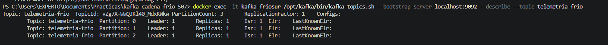
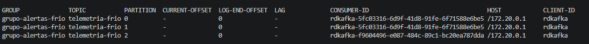
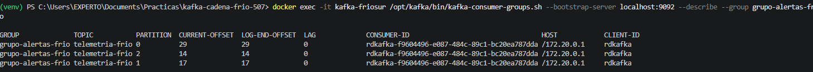

# Monitorización en Tiempo Real de la Cadena de Frío — FríoSur Logística

Pipeline de ingesta y procesamiento de eventos en tiempo real basado en **Apache Kafka (modo KRaft)** para detectar roturas de la cadena de frío (temperaturas > -18,0 °C) en una flota de transporte refrigerado (`CAM-01` a `CAM-04`).

---

## 1. Arquitectura y Estructura del Proyecto

El sistema despliega un bróker de Apache Kafka sin Zookeeper mediante Docker y desacopla la emisión de telemetría de su consumo mediante un *topic* particionado (`telemetria-frio`, 3 particiones) con garantía de entrega **At-Least-Once** (`enable.auto.commit=False` y confirmación síncrona tras persistir en disco).

```text
kafka-cadena-frio-507/
├── evidencias/
│   ├── alertas_detectadas.log          # Log persistente de alertas (E4)
│   ├── E1_topic_describe.png           # Configuración y particiones del topic (E1)
│   ├── E2_productor_salida.txt         # Salida de los 60 eventos enviados (E2)
│   ├── E3A_group_antes_fallo.png       # Reparto inicial entre 2 consumidores (E3-A)
│   └── E3B_group_despues_fallo.png     # Rebalanceo y LAG=0 tras caída de un nodo (E3-B)
├── src/
│   ├── productor_frio.py               # Simulador de telemetría IoT (60 eventos)
│   └── consumidor_alertas.py           # Consumidor con commit manual y registro de alertas
├── .gitignore
├── docker-compose.yml                  # Despliegue de Apache Kafka en modo KRaft
├── README.md                           # Documentación y análisis técnico
└── requirements.txt                    # Dependencias Python (confluent-kafka==2.16.2)
```

---

## 2. Guía de Reproducción del Entorno

### Requisitos previos
* Docker y Docker Compose instalados.
* Python 3.10 o superior.

### Paso 1: Levantar el clúster Kafka y crear el *topic*
Inicia el contenedor de Kafka en segundo plano y crea el *topic* `telemetria-frio` con 3 particiones:

```powershell
docker compose up -d

docker exec -it kafka-friosur /opt/kafka/bin/kafka-topics.sh --bootstrap-server localhost:9092 --create --topic telemetria-frio --partitions 3 --replication-factor 1

# Verificar configuración del topic (Evidencia E1)
docker exec -it kafka-friosur /opt/kafka/bin/kafka-topics.sh --bootstrap-server localhost:9092 --describe --topic telemetria-frio
```

### Paso 2: Preparar el entorno Python
Crea y activa un entorno virtual e instala la librería cliente:

```powershell
python -m venv venv
.\venv\Scripts\Activate.ps1
pip install -r requirements.txt
```

### Paso 3: Ejecutar consumidores, productor y prueba de reequilibrio
1. **Abrir dos terminales (Terminal 1 y Terminal 2)** con el entorno activo y lanzar dos instancias del consumidor en paralelo bajo el grupo `grupo-alertas-frio`:
   ```powershell
   python src/consumidor_alertas.py
   ```
2. **Comprobar el reparto inicial de particiones (Evidencia E3-A)** desde una tercera terminal:
   ```powershell
   docker exec -it kafka-friosur /opt/kafka/bin/kafka-consumer-groups.sh --bootstrap-server localhost:9092 --describe --group grupo-alertas-frio
   ```
3. **Lanzar el productor (Evidencia E2)** en la Terminal 3 (emite 60 lecturas con ~8 anomalías térmicas):
   ```powershell
   python src/productor_frio.py
   ```
4. **Simular caída de nodo:** A mitad de la ejecución (alrededor del evento 25–30), detener uno de los consumidores pulsando `Ctrl + C`. Kafka reequilibrará automáticamente las particiones hacia el consumidor superviviente.
5. **Verificar tolerancia a fallos y persistencia (Evidencias E3-B y E4):** Al finalizar los 60 envíos, comprobar que `LAG = 0` en todas las particiones y que el número de líneas en `evidencias/alertas_detectadas.log` coincide con las anomalías emitidas por el productor:
   ```powershell
   docker exec -it kafka-friosur /opt/kafka/bin/kafka-consumer-groups.sh --bootstrap-server localhost:9092 --describe --group grupo-alertas-frio
   (Get-Content .\evidencias\alertas_detectadas.log).Count
   ```

---

## 3. Evidencias de Ejecución

| Evidencia | Descripción | Archivo |
| :--- | :--- | :--- |
| **E1** | Descripción del *topic* `telemetria-frio` con 3 particiones activas |  |
| **E2** | Ejecución completa del productor (60 eventos y total de anomalías) | [E2_productor_salida.txt](evidencias/E2_productor_salida.txt) |
| **E3-A** | Estado de `grupo-alertas-frio` con 2 consumidores activos |  |
| **E3-B** | Estado tras caída de 1 consumidor: rebalanceo a 1 nodo y `LAG = 0` |  |
| **E4** | Log de alertas persistidas en disco con verificación de recuento | [alertas_detectadas.log](evidencias/alertas_detectadas.log) |

---

## 4. Análisis Técnico de Arquitectura

### 4.1. HDFS frente a Kafka: Solución al *Small Files Problem*
Kafka al crear pocos ficheros de registro en vez de escribir miles de diminutos JSON, lo que elimina la sobrecarga de datos y permite desacoplar la ingesta en tiempo real

### 4.2. Claves y paralelismo
Si enviáramos los mensajes sin clave (`key=None`), Kafka dejaría de aplicar el hash determinista por camión y repartiría los eventos entre las 3 particiones mediante balanceo por turnos . Dado que Kafka únicamente garantiza el orden estricto de los mensajes dentro de una misma partición y no entre particiones distintas, las lecturas de un mismo vehículo  acabarían  en diferentes particiones y podrían procesarse desordenadas en el tiempo.

En Kafka, la unidad máxima de paralelismo dentro de un mismo grupo es la partición (una partición solo puede asignarse a un único consumidor del grupo de forma simultánea). Al mantener 3 particiones en `telemetria-frio` y conectar 4 consumidores en `grupo-alertas-frio`, tres instancias leerán una partición cada una y la cuarta quedará inactiva, sin recibir mensajes, actuando únicamente como nodo de respaldo en caso de que caiga alguno de los otros tres.

### 4.3. Puente hacia Apache Spark (`KAFKA_ADVERTISED_LISTENERS`)
Para que coexistan el acceso externo desde Windows (`localhost:9092`) y el acceso interno entre contenedores Docker (`kafka:29092` / red interna) sin conflictos de resolución DNS, es necesario configurar dos *listeners* independientes en puertos distintos dentro de `docker-compose.yml`:KAFKA_ADVERTISED_LISTENERS: PLAINTEXT://kafka:29092,PLAINTEXT_HOST://localhost:9092
